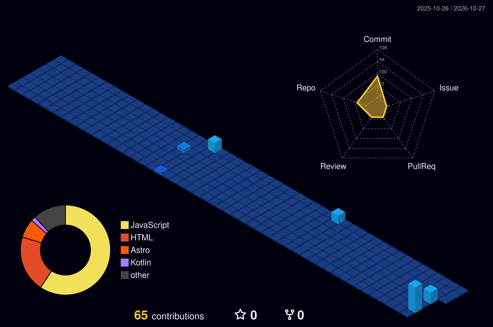

<div align="center">


<a href="https://git.io/typing-svg">
  
</a>

<br/>


[](https://www.linkedin.com/in/aishathshafa)
[](mailto:aishathshafaofficial@gmail.com)

</div>

```text
aishath@github
+----------------------------------------------------------------------
| Role ....................... Software Engineer
| Current .................... Isle Web (Freelance), Mar 2026 to Present
| Focus ...................... Database design, backend, frontend, cloud
| Education .................. BSc (Hons) Software Engineering, Dual Award
|                              De Montfort University (UK)
|                              Asia Pacific University (Malaysia)
|
| Languages.Programming ...... Python, JavaScript, Java, C#, C++, Kotlin, Dart, R
| Databases .................. PostgreSQL, MySQL, SQL
| Web.Systems ................ React, React Native, Node.js, Express.js, Astro
| Cloud.Tools ................ AWS, Git, Postman, Android Studio, Visual Studio
| Practices .................. SDLC, Agile, Software Architecture, Automated Testing
|
| Languages.Spoken ........... English, Dhivehi
|
| Contact
|   Email .................... aishathshafaofficial@gmail.com
|   LinkedIn ................. linkedin.com/in/aishathshafa
|   GitHub ................... github.com/aishshafa
+----------------------------------------------------------------------
```

## About

Software engineer who develops, tests and implements systems, websites and databases, from database design and backend through to the frontend and cloud deployment. Experienced in database design, API and automated testing, preparing data for reporting, and writing clear technical documentation.

I currently work as a freelance software engineer, delivering projects end to end, and I am also developing a peer-to-peer shopping platform.

## Experience

**Software Engineer, Isle Web** | Mar 2026 to Present
*Freelance, end-to-end delivery for diverse client projects*
- Develop, test and implement client systems and websites as the sole engineer, from initial database design and backend infrastructure to frontend development and cloud deployment.
- Plan and design the databases behind each product and build the backend infrastructure that serves them.
- Designed, built and launched the company website, [isleweb.com](https://isleweb.com).

**Sole Web Developer, Zoom Travels** | Jan 2026 to Mar 2026
- Sole developer of [zoomtravels.net](https://zoomtravels.net), a responsive single page static site built with Astro 5 (Vite) and Tailwind CSS 4, structured as reusable components composed through a shared layout.
- Implemented scroll driven animations with GSAP ScrollTrigger, including element reveals, staggered cards, hero parallax and a sticky video hero.
- Built scroll aware navigation, active section tracking and expandable FAQs using Alpine.js, with WhatsApp, social media and email contact links.

**Intern, Ministry of Health** | Jun 2025 to Jul 2025
- Developed a major part of a national health statistics platform prototype for the Digital Health Blueprint, using React Native, Node.js/Express and PostgreSQL.
- Designed the PostgreSQL database schema and tested the APIs with Postman.
- Documented the architecture and handed over the source code to the division's internal team for continued development.

## Selected Work

| Project | Description | Stack |
| :--- | :--- | :--- |
| [isleweb.com](https://isleweb.com) | Company website for Isle Web, designed, built and launched end to end | Web, backend, cloud |
| [zoomtravels.net](https://zoomtravels.net) | Responsive single page site with scroll driven animations and component based layout | Astro 5, Tailwind CSS 4, GSAP, Alpine.js |
| National health statistics platform | Prototype for the Digital Health Blueprint, Ministry of Health | React Native, Node.js, Express, PostgreSQL |
| Peer-to-peer shopping platform | Marketplace connecting buyers and sellers directly, in development | In development |

## Tech Stack

<div align="center">

**Languages**


**Web and Systems**


**Databases**


**Cloud and Tools**


</div>

## Education

- **BSc (Hons) Software Engineering, Dual Award**, 2022 to 2025
  De Montfort University (UK) and Asia Pacific University (Malaysia)
- **Degree Foundation in Business and IT**, 2018
  Asia Pacific Institute of Information Technology

## GitHub Activity

<div align="center">


</div>

### Contributions in 3D

<div align="center">

</div>

### Contribution Snake

<div align="center">
<picture>
  <source media="(prefers-color-scheme: dark)" srcset="https://raw.githubusercontent.com/aishshafa/aishshafa/output/github-snake-dark.svg" />
  <source media="(prefers-color-scheme: light)" srcset="https://raw.githubusercontent.com/aishshafa/aishshafa/output/github-snake.svg" />
  
</picture>
</div>

<div align="center">

<br/>


</div>
